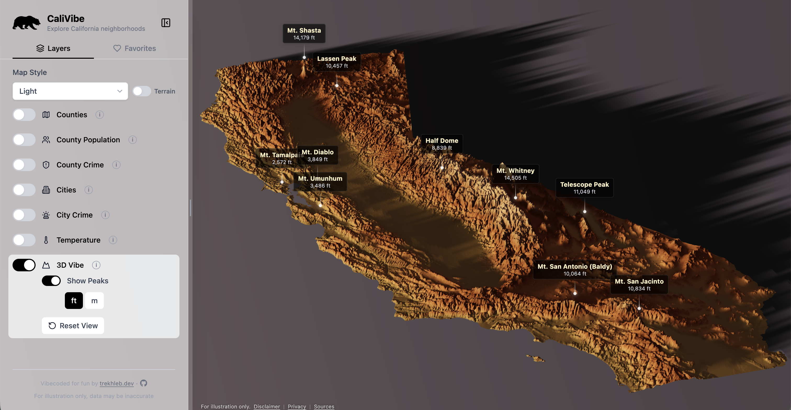
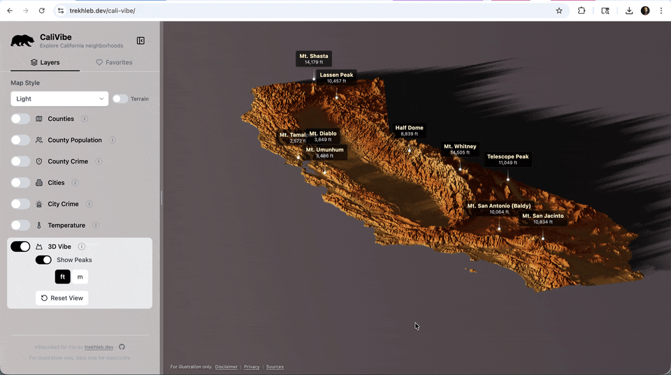
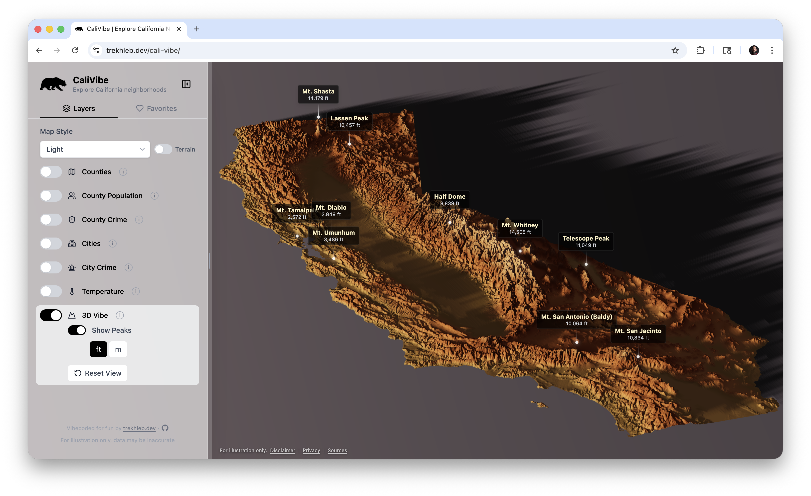
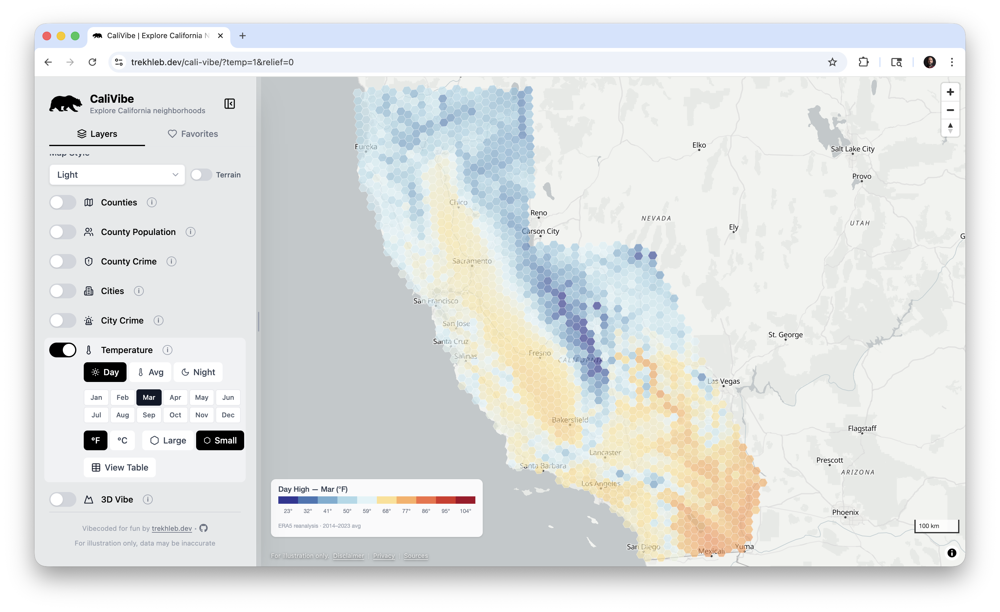
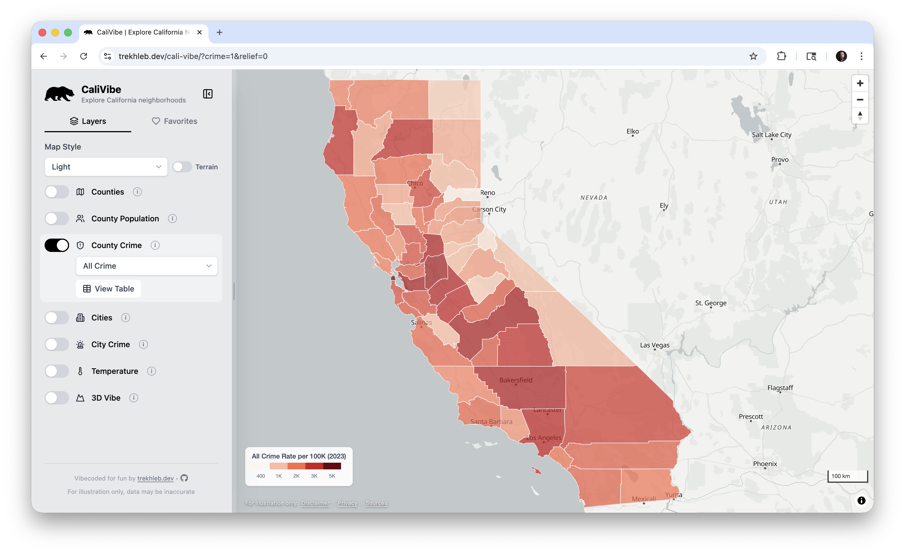
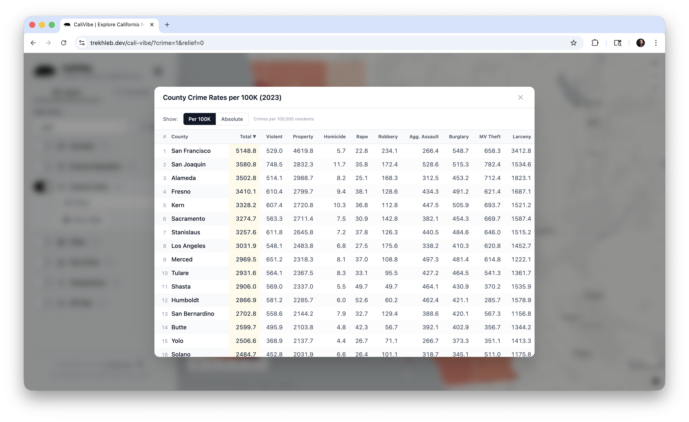
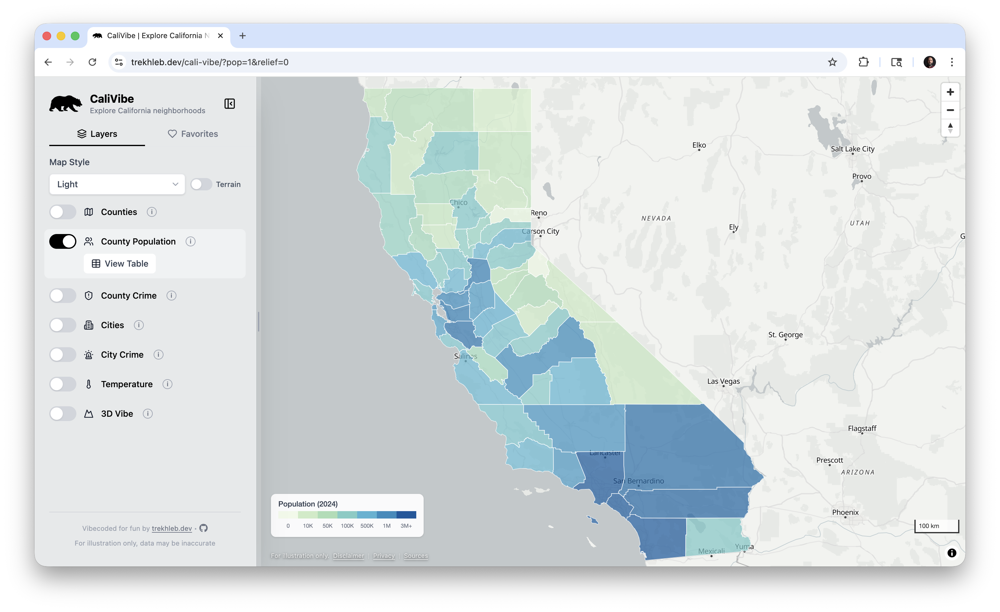
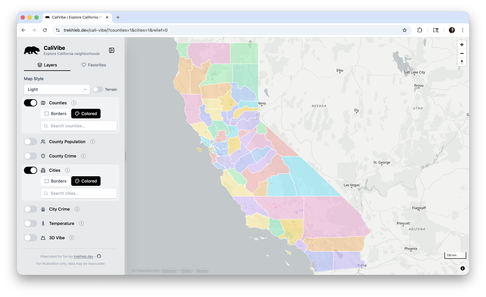

Sometimes it is easier to understand a place through **data** rather than descriptions.

So I built a small interactive app that lets you explore **California counties and cities** using different metrics like:

- population
- crime rates
- temperature trends
- topographical landscape
- and other geographic data

You can try it here:

- 👉 [https://trekhleb.dev/cali-vibe/](https://trekhleb.dev/cali-vibe/)

The project is also open-sourced:

- 👉 [https://github.com/trekhleb/cali-vibe](https://github.com/trekhleb/cali-vibe)

Here is a quick demo of the main data layers that are currently available:

## What you can explore

The app lets you quickly switch between different datasets and see how regions compare.

For example, you can explore:

- **Population distribution**
- **Crime statistics**
- **Temperature trends**
- **Terrain elevation**

Each dataset can reveal interesting patterns across California counties and cities.

## Example views

### Terrain view

### Temperature trends

### Crime rates per city/county

### County population

### County/city borders

## Tech stack

The app is intentionally simple and fully client-side.

**Frontend**

- React
- TypeScript
- Vite
- Tailwind CSS

**Visualization**

- MapLibre GL
- Three.js

**Data**

- JSON datasets are loaded as static assets.

## Data sources

Some of the data used in the project comes from:

- CA DOJ OpenJustice
- California Department of Finance
- US Census Bureau
- Open-Meteo climate datasets
- Terrain tiles from AWS

The processed datasets are included in the repository.

## Development experiment

Another interesting aspect of this project is that it was mostly **AI-assisted development**.

I vibe-coded for fun: `~98%` of the code was written by `Claude Code Opus` with a few sprinkles from `Gemini 3.1 Pro`.

This made it possible to move from idea → working prototype very quickly.

## Why I built this

I enjoy building small interactive tools that help explore data visually.

Sometimes a **map + a few sliders** can reveal patterns much faster than tables or reports.

This project was mostly a weekend experiment, but it turned into a fun way to explore California through data.

## Source code

If you're curious how it works internally:

👉 [https://github.com/trekhleb/cali-vibe](https://github.com/trekhleb/cali-vibe)

Feedback, ideas, and improvements are welcome.
