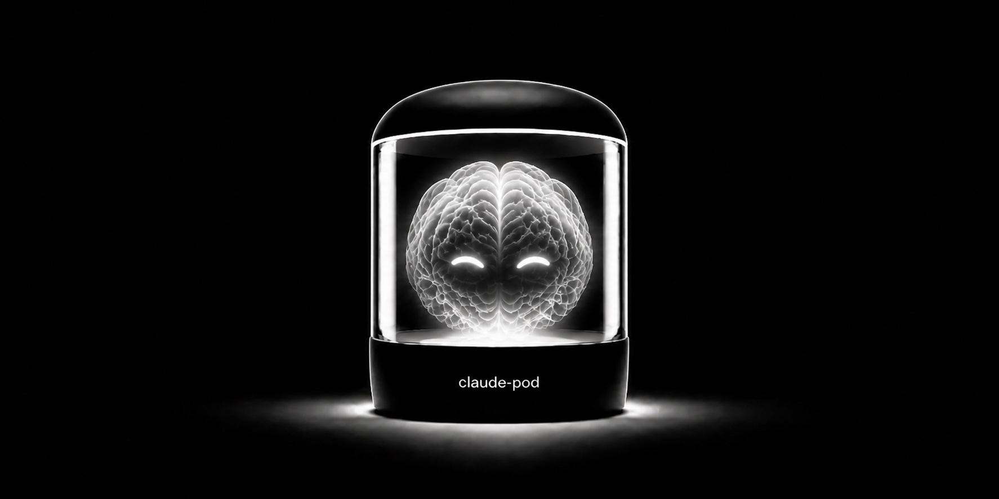

[https://github.com/trekhleb/claude-pod](https://github.com/trekhleb/claude-pod)

Claude Code's `--dangerously-skip-permissions` flag skips per-action approvals — a real productivity boost that helps to avoid manual approval fatigue. The downside: with permissions skipped, Claude can read everything in your home directory, run any command, and modify any file outside your project.

The [**claude-pod**](https://github.com/trekhleb/claude-pod) is a small, unofficial Docker sandbox that wraps Claude Code so it can only see the project folder you launched it from. Four files, MIT-licensed, Docker as the only host requirement. Below is the full README — what it does, what it doesn't protect, and how to use it.

## TL;DR

`claude-pod` runs Claude Code inside a Docker container that mounts the project folder you launch it from. Claude can read and edit that folder; the rest of your machine — home directory, SSH keys, other projects, host shell — isn't mounted, so the container can't see it.

It's useful in two cases:

- With `--dangerously-skip-permissions`: you get auto-approval without giving Claude access to your whole machine.
- In normal, prompt-by-prompt mode: the container still caps the blast radius, so an over-broad command, prompt injection, or a malicious dependency can't reach past the project folder.

It's not full isolation — here's the boundary:

- ✅ **Outside the launch folder is unreachable.** Your home directory, `~/.ssh`, `~/.aws`, other projects, and the host shell aren't mounted, so the container can't see them.
- ⚠️ **Inside the launch folder is fully exposed.** Any `.env`, `.git/config`, or keys in it are readable and writable; outbound network is open, so contents can be read or exfiltrated; and your Anthropic login is stored on the host under `~/.claude-pod/`.
- 🚫 **Don't launch from `~` or `/` or other sensitive folders.** That mounts your whole home or filesystem into the container and defeats the point.

The practical effect: the worst case is narrowed from "your whole machine" to "this one folder," which is recoverable from git.

```bash
# Clone this repo once, anywhere you like (~/tools/claude-pod is just an example)
git clone https://github.com/trekhleb/claude-pod.git ~/tools/claude-pod

# Build the image (once) — runs from anywhere, no cd needed
~/tools/claude-pod/install.sh

# cd into your project, then launch Claude
cd ~/projects/your-project
~/tools/claude-pod/claude-pod claude --dangerously-skip-permissions

# Long path? You can alias it — see "Aliases" below.

# Forgot a command later? Print a copy-pastable cheatsheet of all of them
~/tools/claude-pod/claude-pod --help
```

Docker is the only requirement — no Node.js, npm, or `claude` needed on your host. For the full threat model and the four-file design, see [Security and limits](#security-and-limits). For the official approach, see Anthropic's [Claude Code sandboxing documentation](https://code.claude.com/docs/en/sandboxing).

## Usage

### Requirements

**Just Docker.** Claude Code runs inside the container, not on your host — you do not need Node.js, npm, or the `claude` CLI installed on your machine. The host stays untouched apart from one state folder (`~/.claude-pod/`) that exists only to keep your login across container restarts.

### Running claude-pod

Call the script using its full or relative path from any project:

```bash
cd ~/projects/anything
~/tools/claude-pod/claude-pod
```

You land in a bash shell at the same path your project lives at on the host (e.g. `/Users/you/projects/anything`), with `claude` on `PATH`. Run it however you like:

```bash
claude --dangerously-skip-permissions
```

Alternatively, you may skip the shell and go straight into Claude. Anything you pass to `claude-pod` is run inside the container instead of bash. So this drops you directly into Claude in one command, and exits the container when Claude exits:

```bash
~/tools/claude-pod/claude-pod claude --dangerously-skip-permissions
```

To exit, type `exit`.

Forgot a command later? Run `~/tools/claude-pod/claude-pod --help` (or `-h`) anytime — it prints a copy-pastable cheatsheet of every command (run, install, update, uninstall, options), with the correct absolute paths for your install.

### Aliases

For your convenience, you can add an alias to your shell configuration file (`~/.zshrc`, `~/.bashrc`, etc.):

```bash
alias claude-pod=~/tools/claude-pod/claude-pod
```

This is the shell-first form: `claude-pod` drops you into the container with `claude` on `PATH`, so you can run `npm install`, a dev server, or tests and then start `claude` yourself — all inside the sandbox. The same alias also goes straight into Claude when you pass the command through: `claude-pod claude --dangerously-skip-permissions`.

### First launch (login)

The first time you start Claude inside the pod, it will print a login URL. Open it in your host browser, complete the login, paste the verification code back into the container, and you're done. The session persists in `~/.claude-pod/` and survives container restarts — you only do this once per machine.

### Exposing ports

By default, `claude-pod` doesn't publish any ports to the host (outbound traffic is still unrestricted — see [What is and isn't isolated](#what-is-and-isnt-isolated)). Map ports through with the `PORTS` environment variable:

```bash
# Map a single port (127.0.0.1:3000 -> container:3000)
PORTS=3000 claude-pod

# Map multiple ports
PORTS="3000 5173" claude-pod

# Map a specific host port to a different container port
PORTS="8080:80" claude-pod

# Or, alternatively, without using aliases
PORTS="5173:5173" ~/tools/claude-pod/claude-pod
```

> **Bind your dev server to `0.0.0.0` inside the container, not `localhost`.** Most dev servers default to `localhost`, which means they only listen on the container's own loopback — your host browser can't reach them even with `PORTS=...` set. Common fixes:
> - **Vite:** `npm run dev -- --host` (or `vite --host 0.0.0.0`)
> - **Next.js:** `next dev -H 0.0.0.0`
> - **Create React App / webpack-dev-server:** `HOST=0.0.0.0 npm start`
> - **Django:** `manage.py runserver 0.0.0.0:8000`
> - **Rails:** `rails s -b 0.0.0.0`
>
> The host-side mapping is still `127.0.0.1`-only (forced by `claude-pod`), so binding `0.0.0.0` inside the container does not expose your dev server to your LAN.

### Updating or pinning the Claude Code version

By default, `install.sh` fetches whatever's currently `latest` on npm, bypassing Docker's cache for that step. It resolves its own location, so you can re-run it from any folder:

```bash
~/tools/claude-pod/install.sh
```

To pin a specific version, set `CLAUDE_CODE_VERSION`:

```bash
CLAUDE_CODE_VERSION=2.0.0 ~/tools/claude-pod/install.sh
```

Pinned versions cache normally across rebuilds. The script prints the resolved version after each build, so you always know what you got.

### Customizing the image

The image is intentionally minimal: `node:24-slim` + `git` + `curl` + `less` + `jq` + `gh` + Claude Code. Nothing language-specific. Anything your projects need (Python, build tools, other toolchains) you add yourself — edit the `Dockerfile` and re-run `~/tools/claude-pod/install.sh`.

## Security and limits

### What it actually does

The whole tool is four tiny files:

- **`Dockerfile`** — `node:24-slim` + `git` + `curl` + `less` + `jq` + `gh` + `@anthropic-ai/claude-code`.
- **`claude-pod`** — one `docker run` command that mounts your current directory (plus a small state dir for login and history) and nothing else of your machine.
- **`install.sh`** — checks Docker and builds the image. Doesn't touch any system path; the tool stays self-contained in this folder.
- **`uninstall.sh`** — removes the image and `~/.claude-pod/` (auth + session history) after confirmation. Lists what it doesn't touch so you can clean those up yourself.

### What is and isn't isolated

**Safe from Claude:**
- Everything outside the project folder you launched from. `~/.ssh`, `~/.aws`, `~/.zshrc`, browser data, other projects — all unreachable.
- The host shell. No way to execute commands on your host machine.

**Still exposed:**
- **The project folder itself.** Anything inside it — `.env`, `.git/config` (which can carry credentials for private remotes), private keys committed by mistake, `node_modules`, sibling worktrees, scratch files — is fully readable *and* writable by code running in the container. Don't run `claude-pod` from a folder whose contents you wouldn't trust the AI (or a malicious dependency it just installed) to see and modify.
- **The network.** Outbound is unrestricted by default. A malicious payload could exfiltrate the project contents or burn your Anthropic API quota. For offline work you can cut networking entirely with `NET=none` (see [Network isolation and resource limits](#network-isolation-and-resource-limits)), but that also takes Claude itself offline — there's no built-in egress allowlist that would keep Claude online while blocking everything else.
- **Your Anthropic login** (stored in `~/.claude-pod/` on the host, separate from any host Claude install, shared across sandboxed projects).

**Where Claude can actually write** — two paths, both intentional bind mounts:
- The project folder, bind-mounted at the same path inside the container (`$PWD:$PWD`). Edits land on your host's disk directly, no copy.
- `~/.claude-pod/` on the host, mounted at `/home/claude-pod/.claude`. Holds the auth token and session history.

> Because the current directory (`$PWD`) is mounted into the container, **avoid running this tool from directories like root (`/`) or `/etc` or other sensitive ones**. In such cases you are giving the AI access to your entire machine or to other sensitive data, defeating the purpose of the sandbox. Always `cd` into your specific project folder first.

Everywhere else Claude writes is either in the container's ephemeral filesystem (discarded on exit thanks to `--rm`) or simply has no path to land at — the Linux kernel's mount namespace makes any other host directory invisible to the container. Symlinks inside the project folder pointing to `~/.ssh` or `/etc/passwd` appear broken for the same reason: those targets aren't mounted, so the container can't see them.

> **Hardlinks are different.** A hardlink is a second name for an existing inode on the same filesystem. If a file inside your project folder is hardlinked to a sensitive file elsewhere on the same filesystem (e.g., `~/.ssh/id_rsa`), the container *can* reach it through the hardlink — the bind-mount exposes the inode, not just the path. This requires the hardlink to already exist in the project folder, so it's a real concern only when you're inspecting code from an untrusted source. Treat unfamiliar projects with the same caution you'd apply to running their code directly: don't run `claude-pod` inside a folder you don't trust.

The tradeoff: the worst case becomes "something bad happens to one project folder," which is recoverable from git, instead of "my entire home directory is exposed."

### Network isolation and resource limits

By default the container has **unrestricted outbound network** (Claude needs `api.anthropic.com`, your builds need npm/pip/etc.) and a generous process cap. When you're about to let Claude loose on code from an untrusted source, you can tighten things further with environment variables — all of them just add flags to the same `docker run`, nothing else changes:

```bash
# Cut ALL networking for the run. A malicious payload can't exfiltrate the project or phone home.
# Note: Claude itself can't reach Anthropic with no network, so this is for offline shell/build
# work (inspecting or building untrusted code), not for a live Claude session.
NET=none claude-pod

# Cap memory and CPU so a runaway or malicious build can't exhaust the host (recoverable via OOM,
# but disruptive). No default cap — a fixed limit would kill legitimate large builds.
MEMORY=4g CPUS=2 claude-pod

# Lower the process/thread cap when running untrusted code (default is 4096, generous for builds).
PIDS=512 claude-pod
```

`NET=none` and `PORTS` are mutually exclusive — a container with no network can't publish ports. `--pids-limit` is always applied (it contains fork bombs, which dropped capabilities do *not* prevent); raise `PIDS=` if a very parallel build hits the ceiling.

### Side effects outside the project folder

Everything this repo causes to exist outside the project you launch it from:

- `~/.claude-pod/` on your host — auth token, settings, and per-project session/conversation history (transcripts can include code snippets and command output Claude saw). Auth and settings are shared across projects (one login, ever); session history lives under `~/.claude-pod/projects/<encoded-host-path>/`, one folder per project, using the same encoding host-Claude uses — so if you ever switch to a host install, you can copy the folders over and keep your transcripts. This is *not* a host Claude install; it's a state directory for the container's Claude, kept on the host so it survives restarts.
- Docker image `claude-pod` (~700 MB) and its layers, plus the `node:24-slim` base image, in Docker's image store.
- Docker build cache from `apt-get` and `npm install` steps.
- Outbound network during build: Docker Hub, Debian apt mirrors, npm registry. During runtime: `api.anthropic.com` and whatever your project code reaches (network is unrestricted).
- While a session is running: one container process, and any ports you explicitly mapped via `PORTS` bound on `127.0.0.1`.

No `sudo`, no writes to `/usr/local/`, `/etc/`, `~/.zshrc`, `~/Library/`, your existing `~/.claude/`, or anywhere else on the host.

## Reference

### Platforms

The wrapper is portable POSIX bash + Docker. It should work on any host with a recent Docker:

- **macOS** (Apple Silicon and Intel) with Docker Desktop, OrbStack, or Colima — primary development target.
- **Linux** with Docker Engine or Docker Desktop — bind mounts and `--user` UID/GID map directly here, the most native experience.
- **Windows + WSL2** with Docker Desktop's WSL2 backend — run `claude-pod` from inside a WSL distribution's bash shell.

**Native Windows** (`cmd.exe` / PowerShell) is not supported. The wrapper is a bash script and uses POSIX tools (`id`, etc.); use WSL2 instead.

If a platform doesn't behave as expected, please open an issue.

### Uninstall

```bash
~/tools/claude-pod/uninstall.sh
```

Removes `~/.claude-pod/` and the `claude-pod` image after confirmation. Tells you exactly what it isn't touching (`node:24-slim`, build cache, this repo) and how to clean those up yourself.

If you added a shell alias for convenience (e.g. `alias claude-pod=...` in `~/.zshrc` / `~/.bashrc`), remove that line too — `uninstall.sh` doesn't touch your shell rc files.

### License and trademarks

The code in this repository is released under the MIT License — see [LICENSE](https://github.com/trekhleb/claude-pod/blob/main/LICENSE) for the full text.

Claude Code itself is a separate product owned by Anthropic, PBC, and is **not** redistributed by this project — `install.sh` fetches it from npm at build time. This project is not affiliated with, endorsed by, or sponsored by Anthropic, PBC. "Claude" and "Claude Code" are trademarks of Anthropic, PBC, referenced here nominatively. No Anthropic logos, wordmarks, or other brand assets are used.
